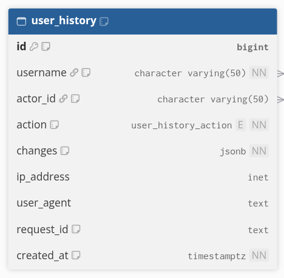

## История изменений пользователя (`user_history`)

Append-only журнал: каждое значимое действие над пользователем (создание, смена email/пароля/роли, вход и т.д.) записывается отдельной строкой.

**Структура записи**

| Поле | Описание |
|------|----------|
| `user_id` | Пользователь, с которым произошло событие |
| `actor_id` | Кто выполнил действие (`NULL` — система) |
| `action` | Тип события (enum `user_history_action`) |
| `changes` | JSONB-diff: `{"email": {"old": "a@x.com", "new": "b@x.com"}}` |
| `ip_address`, `user_agent`, `request_id` | Контекст запроса |
| `created_at` | Время события (UTC) |

**Правила**

- Записи не обновляются (триггер запрещает `UPDATE`); удаляются только по retention-политике.
- В `changes` не пишем секреты: для пароля — только факт смены (`action = 'password_changed'`, `changes = '{}'`).
- Запись истории делаем в **той же транзакции**, что и изменение пользователя.
- Список читается keyset-пагинацией (`before_id`), а не `OFFSET`.

**Пример использования (Go + sqlc)**

```go
err := q.WithTx(tx).CreateUserHistory(ctx, db.CreateUserHistoryParams{
    UserID:    userID,
    ActorID:   pgtype.Int8{Int64: actorID, Valid: true},
    Action:    db.UserHistoryActionEmailChanged,
    Changes:   json.RawMessage(`{"email":{"old":"a@x.com","new":"b@x.com"}}`),
    RequestID: pgtype.Text{String: reqID, Valid: true},
})

// Первая страница
items, err := q.ListUserHistory(ctx, db.ListUserHistoryParams{UserID: userID, PageSize: 50})
// Следующая: BeforeID = items[len(items)-1].ID
```

**Миграции**

```bash
migrate -path migrations -database "$DATABASE_URL" up      # применить
migrate -path migrations -database "$DATABASE_URL" down 1  # откатить
sqlc generate                                              # перегенерировать код
```

---

## База данных

